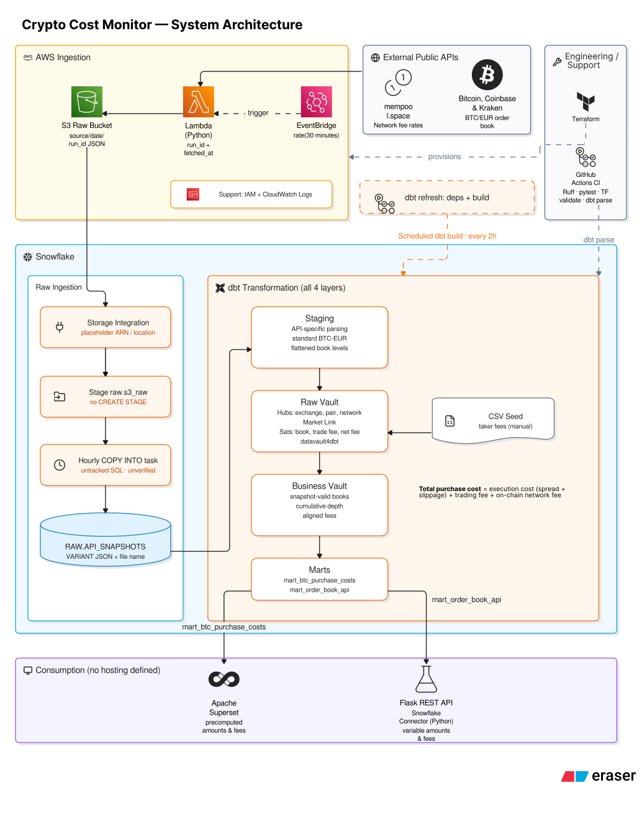
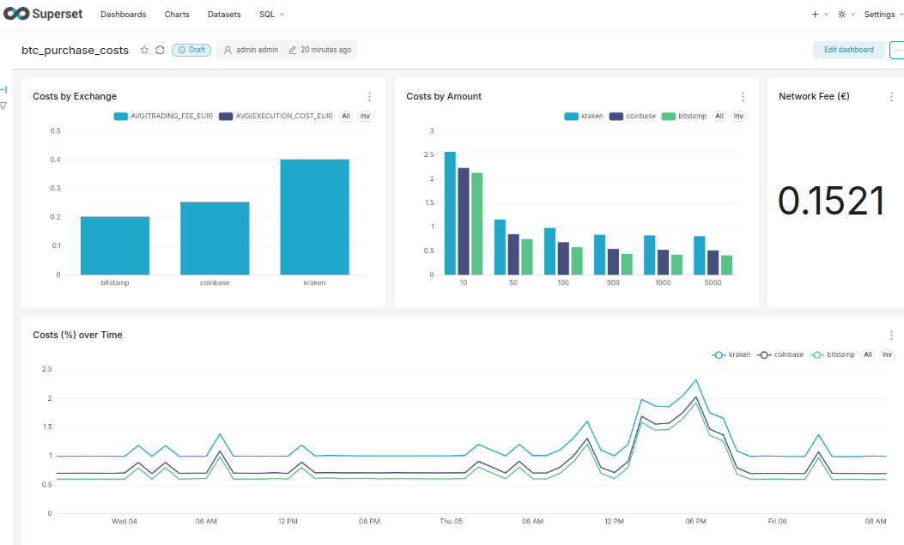

# Crypto Cost Monitor

This project looks into the question "what does it cost to buy a small amount of Bitcoin and send it on-chain?" To answer it, the project collects order books from three exchanges (Bitstamp, Coinbase and Kraken) plus Bitcoin network fee rates (from mempool.space) every 30 minutes. An AWS Lambda function stores the raw API responses in S3, Snowflake loads them, and dbt transforms them through a Data Vault into marts. The results are shown in an Apache Superset dashboard and exposed through a REST API that calculates costs for any amount.


## Architecture and Repo Structure



The dbt architecture in more detail:

| dbt Layer | Content |
|---|---|
| Staging | One model per source: order books flattened to one row per level, harmonised business keys (BTC-EUR) |
| Raw vault | Hubs (exchange, trading pair, network), link (market), multi-active satellites per exchange (order book levels), satellites for network and trading fees (implemented with [datavault4dbt](https://github.com/ScalefreeCOM/datavault4dbt)) |
| Business vault | Book version & fees valid at each run, cumulative depth per level |
| Marts | `mart_btc_purchase_costs` (selected amounts for the dashboard), `mart_order_book_api` (all levels for the API) |

Repository folder structure:

```
src/ingestion/          Lambda ingestion script
src/dbt/                dbt project
src/services/dashboard  Superset dashboard
src/services/api/       Flask REST API
infra/terraform/        AWS infrastructure (S3, Lambda, EventBridge, IAM)
infra/snowflake/        Snowflake setup scripts (run in order)
tests/                  pytest tests for the ingestion
.github/workflows       CI/CD: tests, Ruff and automatic dbt refresh          
```

## Cost model explanation

To be able to understand the projects results, the different cost components are explained in the following. 

Total cost of buying BTC for an amount in EUR = execution cost + trading fee + network fee. Execution cost arise because the order walks through the ask side of the order book; the difference to the mid price roughly covers spread and slippage (in case an order takes more than one level). Trading fees are here defined as the amount × taker fee of the exchange (i.e. lowest retail tier, maintained in the seed exchange_fees.csv). Network fees correspond to the fee rate (sat/vB) × transaction size (140 vB, dbt variable `tx_vbytes`), converted to EUR at the mid price. 

This project assumes that BTC is transferred from a personal wallet, i.e. network fees are considered instead of exchange-specific withdrawal fees. Order book depth is limited to the top 50 levels per side to reduce processing costs, with larger orders marked as not covered. Trading fees are based on publicly available exchange fee schedules rather than account-specific rates.


## Setup

The project requires Python 3.12, Terraform, an AWS CLI with a configured profile (`~/.aws/config`), a Snowflake account and a running Superset instance with snowflake-sqlalchemy installed.

```bash
python -m venv .venv
source .venv/bin/activate
pip install -e .
```

Create and fill out an `.env` in the project root from the `.env.example` and load it into the shell before running Terraform, dbt or the API to make the variables available.

```bash
set -a; source .env; set +a
```

### 1. Snowflake

Run the scripts in infra/snowflake/ in numerical order as ACCOUNTADMIN. They create the warehouse, database, S3 stage, the hourly load task, and read-only or transform roles with service users for dbt, Superset and the API. Copy STORAGE_AWS_IAM_USER_ARN and STORAGE_AWS_EXTERNAL_ID from DESC INTEGRATION into .env for the next step.

Service users authenticate with key pairs. Create one pair per user (dbt_key, superset_key, api_key) and paste the public key into the user's RSA_PUBLIC_KEY:

```bash
openssl genrsa 2048 | openssl pkcs8 -topk8 -inform PEM -out ~/.snowflake/<name>.p8 -nocrypt
openssl rsa -in ~/.snowflake/<name>.p8 -pubout -out ~/.snowflake/<name>.pub
grep -v "PUBLIC KEY" ~/.snowflake/<name>.pub | tr -d '\n'; echo
```

### 2. Ingestion (AWS)

Terraform packages build/ into lambda.zip on apply, so fill it first with the dependencies and the script:

```bash
pip install requests -t build --platform manylinux2014_x86_64 --python-version 3.13 --only-binary=:all:
cp src/ingestion/ingestion.py build/
cd infra/terraform && terraform init && terraform apply
```

To test the script manually, one can run: 

```bash
aws lambda invoke --function-name crypto-cost-monitor-ingestion out.json
aws s3 ls s3://<bucket> --recursive
```

### 3. dbt

```bash
cd src/dbt && dbt debug && dbt deps &&  dbt seed && dbt build
```

The workflow dbt_refresh.yml repeats this every three hours on GitHub Actions. It needs the repository secrets SNOWFLAKE_ACCOUNT and SNOWFLAKE_DBT_PRIVATE_KEY (content of dbt_key.p8).


### 4. Dashboard



Import the zipped dashboard/superset folder in Superset under Dashboards/Import. This also creates the database connection; edit it afterwards to set your account in the URI and add the key under Advanced/Security/Secure Extra:

```json
{
  "auth_method": "keypair", 
  "auth_params": {"privatekey_path": "/path/to/superset_key.p8"}
}
```


### 5. API

```bash
cd src/services/api && python app.py
```


| Endpoint | Description |
|---|---|
| `GET /health` | health check |
| `GET /mid-prices/latest` | mid price per exchange at the latest run |
| `GET /costs?amount=<eur>` | purchase costs, cheapest exchange first |
 
Optional parameters of `/costs`: `exchange` (`bitstamp`, `coinbase`, `kraken`; default all), `fee_type` (`fastest`, `half_hour`, `hour`, `economy`, `minimum`; default `half_hour`) and `at` (timestamp (ISO); default: now). User inputs are passed to Snowflake as bound parameters to protect against SQL injection.

Sample query and output:

```bash
curl "http://127.0.0.1:5000/costs?amount=237&exchange=kraken&fee_type=economy"
```
 
```json
[
  {
    "btc_received": 0.003504108086,
    "exchange_code": "kraken",
    "execution_cost_eur": 0.015418089777,
    "network_fee_eur": 0.0946827,
    "snapshot_ts": "2026-11-06T08:53:49.755611+00:00",
    "total_cost_eur": 2.006100789777,
    "trading_fee_eur": 1.896
  }
]
```

## CI

Every push runs `ruff`, `pytest`, `terraform fmt`/`validate` and `dbt parse` (no database connection needed).

## Future work

- Implement the cost of selling BTC back to EUR using the bid side, which already exists in the available data
- More in depth dbt data tests with dbt-expectations (like row counts or compound uniqueness of satellites)
- CI against a Snowflake schema with real data
